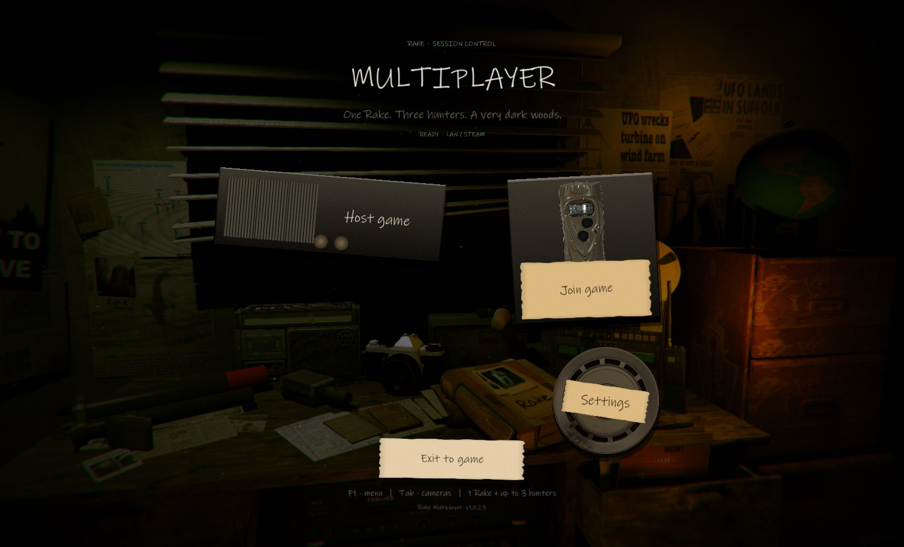
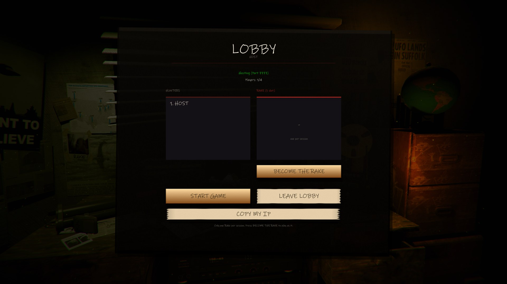
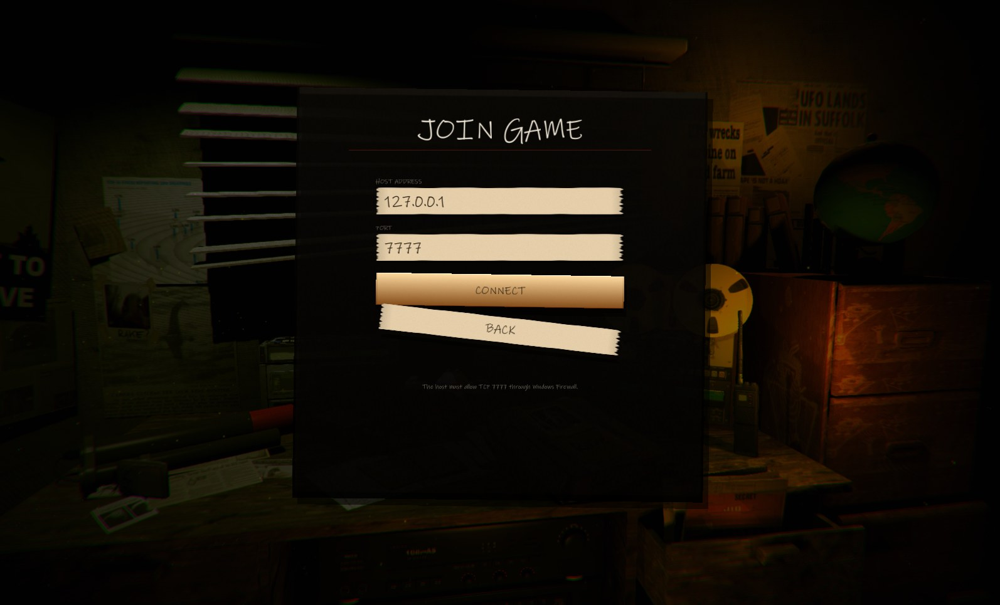
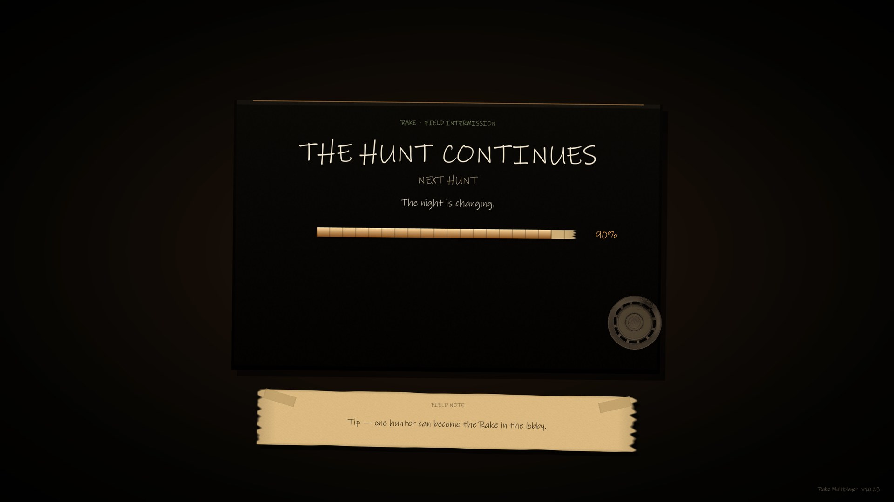
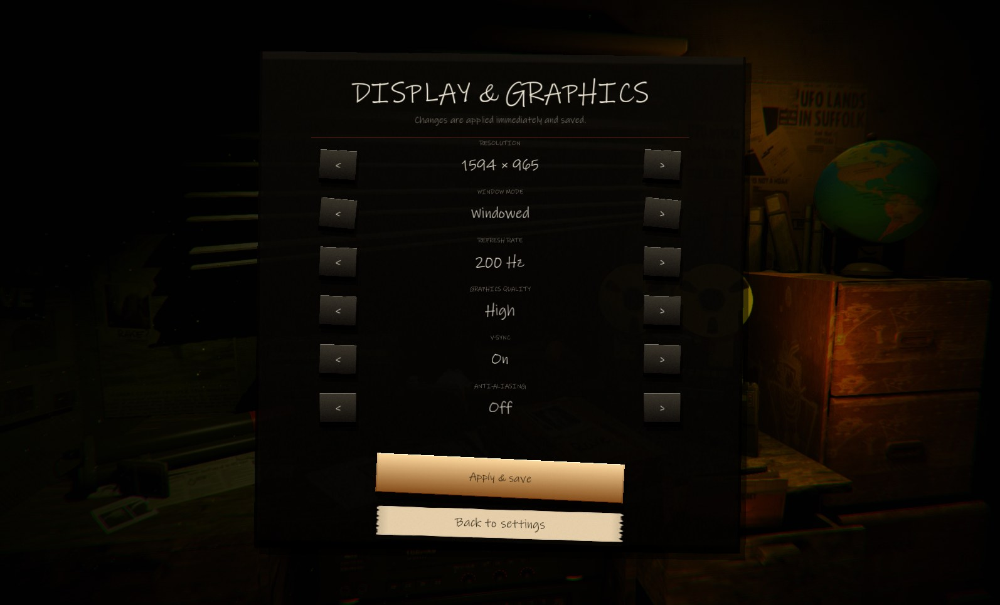
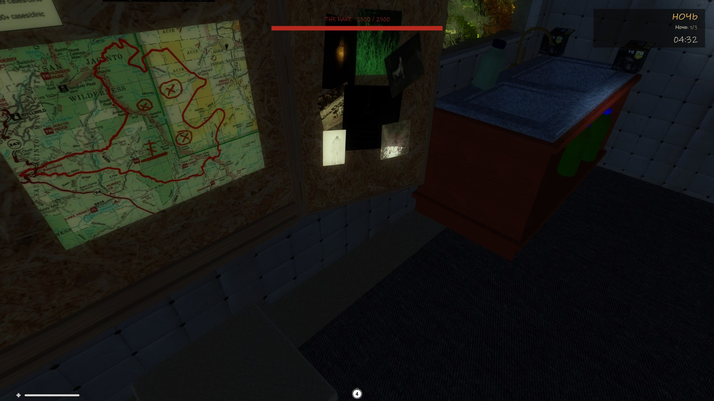
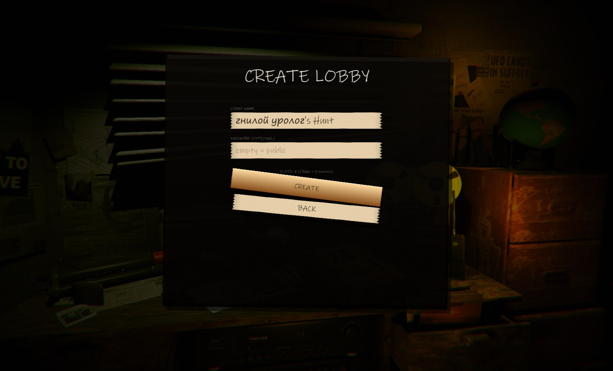

# Rake Multiplayer

**1.1.0-alpha.1** · Windows x86 · Rake (2015)

A cooperative multiplayer mod for **Rake (2015)**: one player takes the Rake,
up to three hunters try to survive the woods. Host-authoritative AI and world
state, LAN and Steam lobbies, a hand-made interface that stays inside the game's
physical desk-room style.

> **Alpha build.** The core loop is playable, but balance, Steam stability and
> some UI details are still changing. See [Known limitations](#known-limitations).



## Screenshots

| | |
|---|---|
|  |  |
|  |  |
|  |  |

More: [host a lobby](docs/screenshots/host.jpg), [Steam browser](docs/screenshots/lobbies.jpg),
[settings](docs/screenshots/settings.jpg).

## Features

- **1 Rake + up to 3 hunters.** Any player can claim the single Rake slot in the lobby.
- **Host-authoritative world.** Rake AI, damage, loot, doors, traps, cameras and the
  day/night phase run on the host and are synchronized to clients.
- **Day / night loop.** The Rake is dormant by day and hunts at night; hunters prepare
  cameras, bait, traps and the map.
- **LAN and Steam.** Direct TCP for LAN/VPN, or Steam lobbies (Spacewar app 480) with a
  lobby browser, password support and invites.
- **New interface.** The vanilla menu room stays as the backdrop; the buttons are
  physical radio/camera/reel cards with hand-written labels, paper notes and a matching
  loading screen.
- **Display & graphics settings.** Resolution, window mode, refresh rate, quality,
  V-Sync and anti-aliasing, saved and re-applied on launch.
- **HUD.** Night phase and timer in the top-right corner; the Rake health bar at the
  top center.

## Install

1. Download `RakeMultiplayerSetup.exe` from the [latest alpha release](../../releases).
2. Point it at the folder containing `Rake.exe` / `Rake_Data`.
3. Launch Rake. The multiplayer menu is the main menu.
4. Host: **Host game → Create LAN lobby** (TCP 7777) or **Create Steam lobby**.
   Join: **Join game** with the host address, or **Steam lobbies**.

The installer adds BepInEx 5.4.23.2 (x86), the mod and Telepathy, and creates
`Uninstall_RakeMultiplayer.exe`.

## Controls

| Key | Action |
|---|---|
| `F1` | Open / close the menu in a match (always open in the main menu) |
| `Tab` | Cycle cameras |
| `F3` | Minimap |
| `Ctrl` | Sneak |
| `` ` `` | Developer console |

Steam is optional for LAN play. Radmin VPN / Hamachi work: enter the host's VPN IP.

## Known limitations

- Steam hosting/browsing is still under test in different regions; LAN is the most
  reliable path in this alpha.
- The Rake AI and balance are tuned for 1 Rake + 3 hunters and may change.
- Some UI text is English while the game itself may be Russian.
- The mod is x86 only, matching the original Unity 5 build.

## Build

Requirements: .NET SDK, BepInEx 5.4.23.2 x86, the game assemblies in `Rake/Rake_Data/Managed`.

```powershell
dotnet build RakeMod/Source/RakeMultiplayer/RakeMultiplayer.csproj -c Release
```

Installer:

```powershell
powershell -ExecutionPolicy Bypass -File RakeMod/Installer/build.ps1
```

Tests:

```powershell
powershell -ExecutionPolicy Bypass -File RakeMod/Tests/run-tests.ps1
```

## Repository layout

- `RakeMod/Source/RakeMultiplayer` — the BepInEx plugin (net35, x86).
- `RakeMod/Installer` — setup builder and payload packer.
- `RakeMod/Tests` — packet / logic tests.
- `RakeMod/ModelBake` — player model pipeline.
- `RakeMod/tools` — developer tools (game MCP bridge, display-dialog patch).
- `GAME_MECHANICS.md` — authoritative gameplay/system notes.
- `CHANGELOG.md` — release-level changes only.

## Credits

Rake (2015) by Konsordo. Mod built with BepInEx 5, HarmonyX and Telepathy.
The interface uses textures extracted from the game and a hand-written system font.
