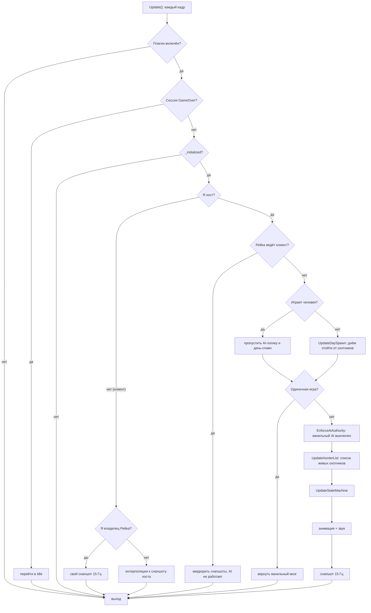
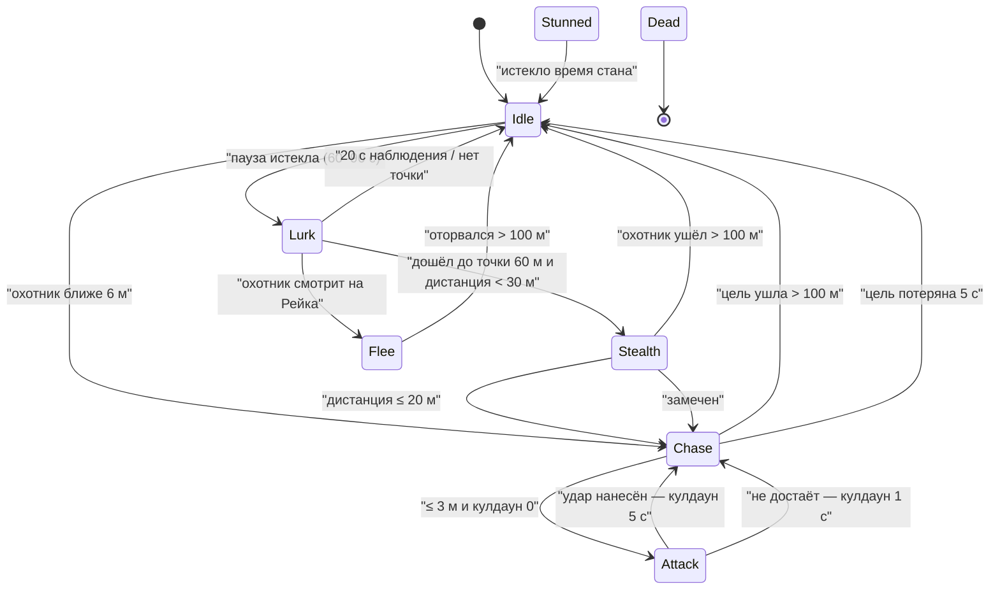
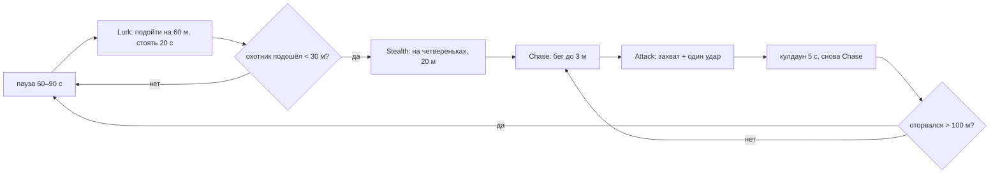

# Rake AI — схема работы

По коду `Components/NetworkedRakeAI.cs` (2 744 строки). Все числа взяты из значений по
умолчанию, а не «примерно».

## 1. Кадровый поток `Update()`

Клиент **никогда** не симулирует Рейка: он либо владелец (публикует свой снапшот), либо
интерполирует чужой. Это проверяется каждый кадр, потому что роль может стать известна
только после `Start()`.

## 2. Конечный автомат состояний

Состояния `Blocking`, `FeignedRetreat` и `Search` имеют обработчики, но **никем не
включаются** — это остатки старого поведения. В схеме их нет, чтобы не путать.

## 3. Один «заход» (encounter)

Пока заход активен (`_encounterActive`), пауза не начинается заново. Пауза ставится
только в `FinishEncounter()` — когда задача действительно закончена: наблюдал 20 с, убежал,
потерял цель, застрял, сломал камеру, наступил день.

## 4. Числа из кода

| Параметр | Значение | Что означает |
| --- | --- | --- |
| `lurkStandoffDistance` | 60 м | точка наблюдения |
| `lurkWatchDuration` | 20 с | сколько стоит и смотрит |
| `sneakStartDistance` | 30 м | с какой дистанции начинает подкрадываться |
| `chargeStartDistance` | 20 м | с какой бросается в атаку |
| `attackRange` | 3 м (+2 м запас на удар) | дистанция удара |
| `fleeStopDistance` | 100 м | дальше — заход закончен |
| `lurkIntervalMin/Max` | 60–90 с | пауза между заходами |
| `lurkCrouchChance` | 0.7 | шанс, что сядет на точке |
| `dayKeepAwayDistance` | 90 м | днём держится на этой дистанции |
| `syncRate` | 0.066 с (15 Гц) | частота снапшотов |
| `interpolationSpeed` | 12 | сглаживание у клиента |
| таймауты | Chase 120 с, Stealth 90 с, Flee 60 с, Lurk 120 с | защита от залипания |
| «нет прогресса» | < 0.35 м за 1 с, 4 раза подряд | заход прерывается |
| слом камеры | проверка каждые 0.5 с в радиусе 2.5 м | ломает ближайшую поставленную камеру |

## 5. Реакция на урон

| Состояние | Что делает |
| --- | --- |
| `Lurk` | уходит в `Flee` — его заметили |
| `Idle` | `Flee`, если охотник дальше 30 м, иначе `Chase` |
| `Stealth`, `Follow` | `Chase` — подкрадываться поздно |
| `Blocking` | урон спереди режется (остаток старой механики) |
| человек за Рейка | +10 с к кулдауну атаки |

## 6. День и ночь

Днём охота запрещена:

- любое активное состояние → `FinishEncounter("day phase")` → `Idle`;
- **если охотников рядом нет** — медленно бродит по лесу: новая точка в радиусе 55 м
  каждые 15–30 с, шагом, молча (раньше стоял статуей);
- **если охотник ближе 90 м** — уходит шагом в точку не ближе 130 м от него (раньше
  телепортировался, что выглядело как баг);
- **если охотник вплотную (< 20 м)** — только тогда варп: уйти шагом уже нельзя;
- если ближайший охотник дальше 1200 м (Рейка выкинуло за карту) — возврат к лесному спавну.

С наступлением ночи пауза укорачивается до 8 с, чтобы ночь не начиналась с ожидания.

## 7. Атака (главное, что изменилось в 1.1.4+)

1. `Chase` подводит к цели на `attackRange`.
2. Перед захватом проверяется, что удар вообще может попасть: дистанция ≤ 5 м и чистая
   линия до цели. Иначе — `Chase` и кулдаун 1 с (раньше держал охотника 1.8 с за стеной).
3. `BeginGrab` замораживает охотника, забирает мышь и разворачивает камеру на Рейка.
4. Один удар, затем `Chase` и кулдаун 5 с.

## 8. Роли в сети

| Кто | Что делает |
| --- | --- |
| Хост, Рейк = AI | полная симуляция, снапшоты 15 Гц |
| Хост, Рейк у клиента | миррорит снапшоты, AI выключен |
| Хост, человек за Рейка | `RakePlayerController` ведёт тело, AI не работает |
| Клиент-владелец | публикует свой снапшот |
| Клиент-наблюдатель | интерполирует снапшот хоста |
| Одиночная игра | ванильный `Enemy_AI` возвращается, мод не мешает |
