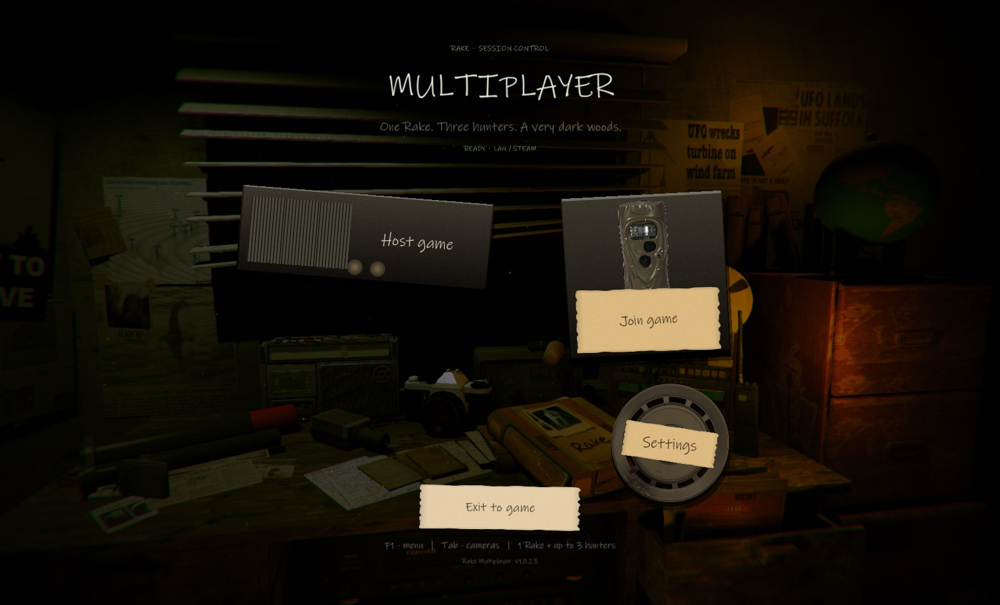
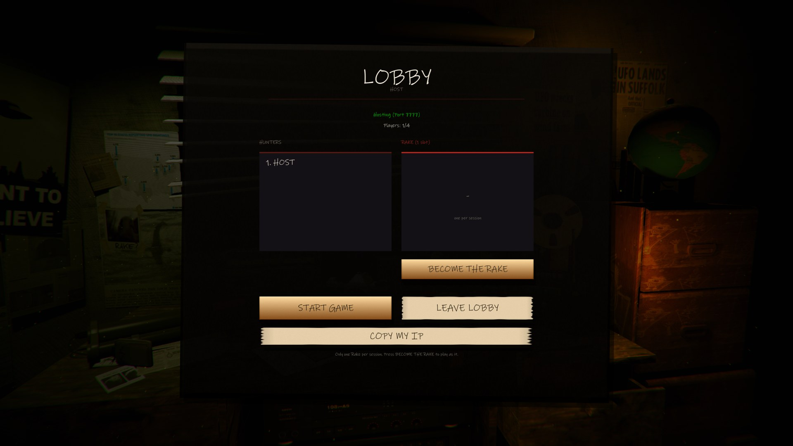
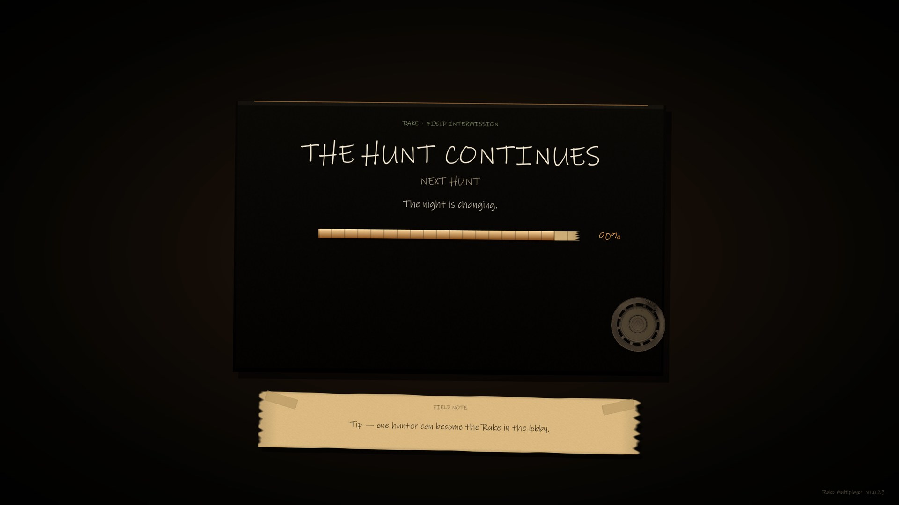
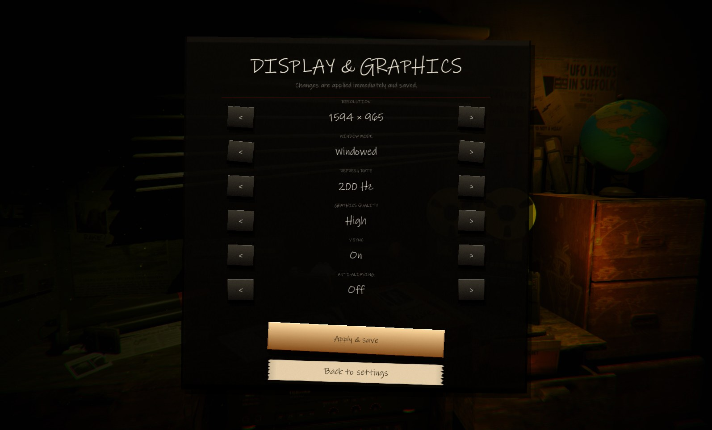
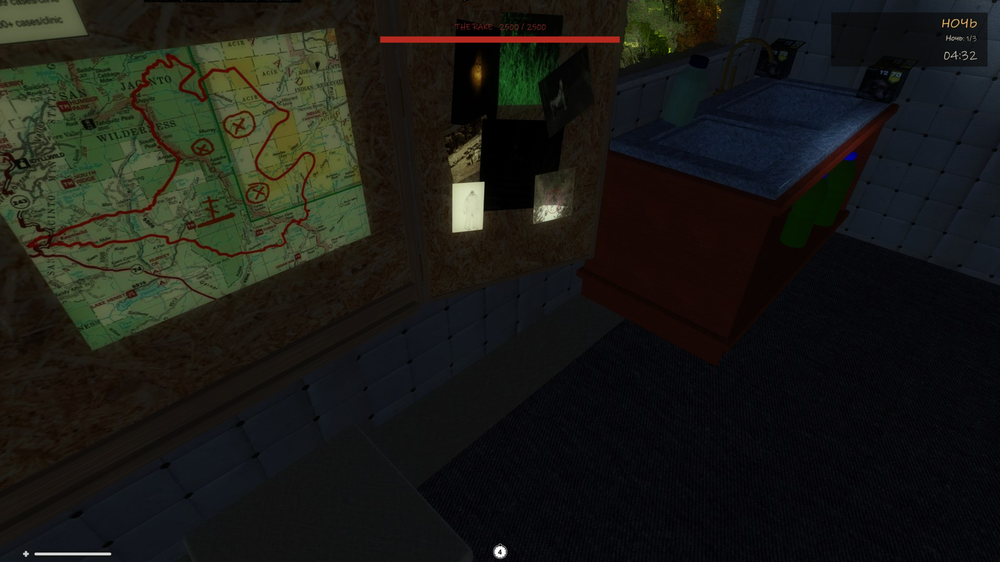

# Rake Multiplayer 1.1.0-alpha.1

**First public alpha** of the cooperative multiplayer mod for **Rake (2015)**.

> Alpha build: the core loop is playable, but balance, Steam stability and some UI
> details are still changing. LAN is the most reliable path in this build.

## Install

1. Download `RakeMultiplayerSetup.exe` below.
2. Point it at the folder containing `Rake.exe` / `Rake_Data`.
3. Launch Rake. The multiplayer menu is the main menu.

The installer adds BepInEx 5.4.23.2 (x86), the mod and Telepathy, and creates
`Uninstall_RakeMultiplayer.exe`.

## What's in this alpha

- **1 Rake + up to 3 hunters**, with a lobby and a single claimable Rake slot.
- **Host-authoritative world:** Rake AI, damage, loot, doors, traps, cameras and
  day/night phase.
- **LAN (TCP 7777)** and **Steam lobbies** (Spacewar app 480) with browser and password.
- **New interface** built over the vanilla menu room: main menu, host/join, Steam
  browser, lobby, settings, display settings and loading screen.
- **Display & graphics settings:** resolution, window mode, refresh rate, quality,
  V-Sync and anti-aliasing; saved and re-applied on launch.
- **HUD:** night phase/timer in the top-right, Rake health bar at the top center.

## Screenshots

## Known limitations

- Steam hosting/browsing is still being tested across regions; use LAN if in doubt.
- Balance and UI details may change.
- x86 only, matching the original Unity 5 build.
- Some UI text is English while the game itself may be Russian.

## Controls

`F1` menu (in a match), `Tab` cameras, `F3` minimap, `Ctrl` sneak, `` ` `` developer console.

## Verification

- Packet and serialization tests: **86/86 passed**.
- Menu, lobby, loading, display settings and HUD checked on the running game.
