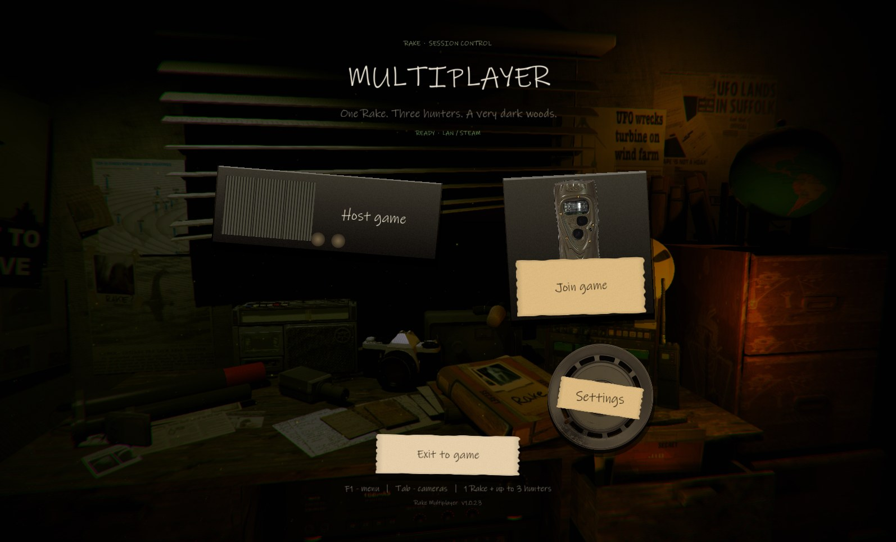
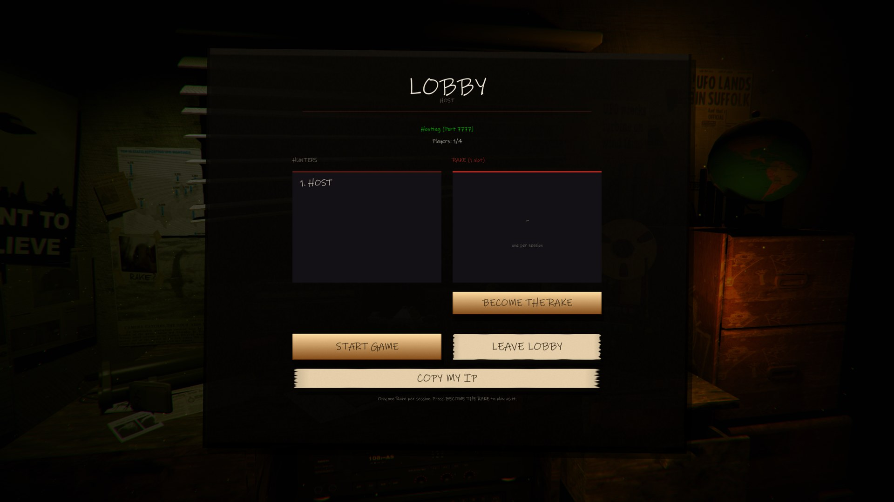
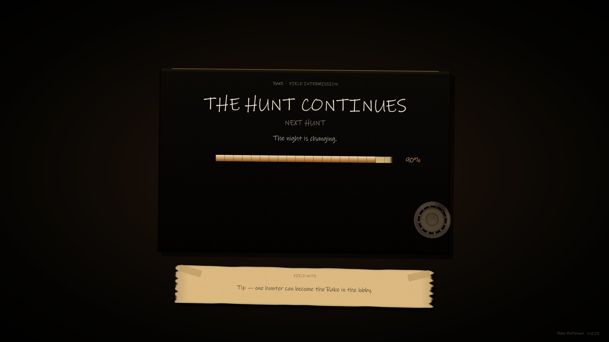
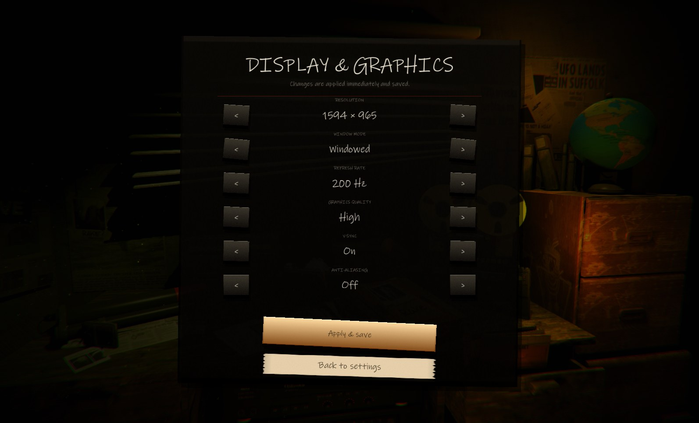
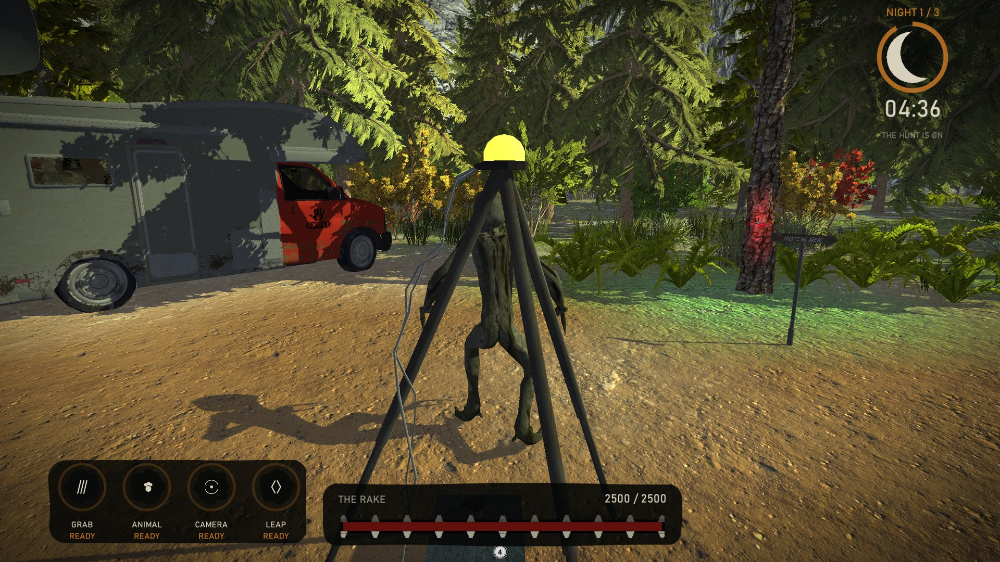

# Rake Multiplayer 1.1.23-alpha.1-Main

> **Main build.** This release is built from the `master` (Main) branch: graphics
> presets, the day/night level change, the HUD phase fix and the climbing guards.
> It does not include the optics or target-refresh work from the other branch.

**First public alpha** of the cooperative multiplayer mod for **Rake (2015)**.

> Alpha build: the core loop is playable, but balance, Steam stability and some UI
> details are still changing. LAN is the most reliable path in this build.

## Install

1. Download `RakeMultiplayerSetup.exe` below.
2. Point it at the folder containing `Rake.exe` / `Rake_Data`.
3. Launch Rake. The multiplayer menu is the main menu.

The installer adds BepInEx 5.4.23.2 (x86), the mod and Telepathy, and creates
`Uninstall_RakeMultiplayer.exe`.

## What's in this alpha

- **1 Rake + up to 3 hunters**, with a lobby and a single claimable Rake slot.
- **Host-authoritative world:** Rake AI, damage, loot, doors, traps, cameras and
  day/night phase.
- **LAN (TCP 7777)** and **Steam lobbies** (Spacewar app 480) with browser and password.
- **New interface** built over the vanilla menu room: main menu, host/join, Steam
  browser, lobby, settings, display settings and loading screen.
- **Display & graphics settings:** resolution, window mode, refresh rate, quality,
  V-Sync and anti-aliasing; saved and re-applied on launch.
- **HUD:** night phase/timer in the top-right, Rake health bar at the top center.

## Fixes

- The Rake no longer spawns on the level's staging platform under the map during the
  day: taking the Rake now puts it on forest ground near the hunters.

## Climbing

- **No more flicker.** The wall probe is volumetric and skips the Rake's own capsule, which
  used to be picked as a "wall" and made the climb blink off and on.
- **Round trunks hold.** The contact normal is smoothed instead of snapped, so the body no
  longer swings left and right on a tree while climbing it.
- **Hanging works:** release the keys and the Rake stays on the wall.
- **Ledges** are pulled over instead of dropping back down.
- **Space always lets go**, even while the jump is cooling down, and the wall cannot be
  grabbed again for two seconds.
- **First person** hides the body while climbing, so the Rake does not see its own arms or face.

## Performance overlay

Press `F8` in a match for a small panel in the top-left corner:

| Row | Meaning |
| --- | --- |
| `FRAME` | wall clock between two frames, ms |
| `CPU` | start of the frame to the end of camera rendering, ms |
| `GPU~` | `FRAME - CPU`: the part of the frame spent waiting for the device |
| `REND` | CPU time spent submitting the cameras, ms |
| `TRIS` | triangles of every visible mesh |
| `DRAW~` | draw calls: one per visible submesh plus one per uGUI element |
| `UI` | uGUI draw calls only |
| `OBJS` | visible renderers |

Unity 5 has no runtime GPU timer, so `GPU~` is an upper bound: with V-Sync on the
frame is capped and the row reads lower than the real device time. Terrain is not
included in `TRIS` (the engine exposes no terrain triangle count).

## Screenshots











## Graphics presets

`[Graphics] Preset` in the config, or **PERFORMANCE PROFILE** in Display & Graphics:

| Preset | LOD bias | Far clip | Shadows | FPS on a forest level |
| --- | --- | --- | --- | --- |
| OFF (VANILLA) | 1.5 | 300 | on | ~40 |
| LIGHT | 1.0 | 300 | on | ~47 |
| BALANCED | 0.7 | 220 | off | ~63 |
| AGGRESSIVE | 0.7 | 120 | off | ~82 |

Measured, not guessed: `docs/perf/graphics-steps.md` has the full staircase. Anti-aliasing,
texture size and pixel lights changed nothing on this CPU-bound frame, so the presets do not
touch them.

## Graphics config

`BepInEx/config/com.rake.multiplayer.cfg`:

| Option | Default | Meaning |
| --- | --- | --- |
| `[Graphics] TerrainShadows` | `false` | `false` turns the terrain shadow pass off (the terrain is one huge caster over every tree it draws); `true` keeps the level as shipped |

The value is applied on every level load and again after a graphics preset change, so it
survives switching quality in the menu. The result is written to the log:

```
[Graphics] terrain shadows OFF on 1 terrain(s) (was ON for 0, changed 0, 29748 tree instances) [scene Level_1(Day), quality High]
```


## Fixes in this build

- The day/night timer now **loads the matching level** (`Level_X(Day)` <-> `Level_X(Night)`)
  instead of only changing the lighting; the loading overlay also closes afterwards.
- Clients mark the cycle as running when the first phase packet arrives, so the HUD shows the
  real phase and the countdown instead of claiming night forever.
- The HUD takes the phase and the night number from the session cycle, falling back to the
  loaded level name before the first packet.
- Climbing no longer locks up: a zero/NaN approach direction or a stale release timer is
  detected and reset instead of silently refusing every wall.

## Fixes in 1.1.3

- **The Rake AI looked frozen.** During the day the AI Rake was teleported to the forest
  marker, which sits in the hunters' own camp, and the day gate stopped it from hunting:
  it stood motionless at arm's length. It now keeps at least 90 m from every hunter and
  silently steps deeper into the trees if someone walks up to it. Night hunting is
  unchanged (lurk -> stealth -> charge -> flee).
- **The F8 overlay threw every frame after a level change** (`An element with the same key
  already exists in the dictionary`). Unity reuses instance ids after a scene load, so a
  stale camera key compared equal to a fresh one; the camera timing copy can no longer
  throw, and the frame timings keep updating across day/night transitions.

## Fixes in 1.1.4

- **The Rake attack is a grab again.** It used to only send damage: the hunter could keep
  running, the camera never turned and the Rake swung on a loop. Now the hunter is held for
  the 1.2 s wind-up (movement frozen, mouse look taken away, camera turned to the Rake),
  hit once, and the grab ends with a 5 s break before another grab can start. Works for the
  host and for clients - the client plays the grab on its own machine.
- **The pause menu buttons work.** The plate canvas had no `GraphicRaycaster`, so clicks
  never reached CONTINUE or EXIT TO MENU.
- **CONTINUE really resumes**: the vanilla `Continue()` hides its own panel but leaves
  `isPaused` true, and the mod's plate follows that flag, so it stayed on top of a running
  game.
- **EXIT TO MENU leaves the match properly**: disconnects, aborts the session, stops the
  day/night cycle (it is DontDestroyOnLoad and otherwise kept changing levels over the menu),
  restores `Time.timeScale` and hides the plate. The main menu is the shipped
  `MainMenu_v2`, so the scene check now accepts level 0 instead of a name that does not exist.
- **"Ignore collision failed" spam** in the log is gone: the ragdoll only pairs colliders
  that are enabled, instead of asking Unity to ignore disabled ones every hit.

## Fixes in 1.1.5

A full-cycle audit (connect -> lobby -> match -> day/night -> death/respawn -> results -> menu)
looked for the same class of bug we kept hitting: half-wired state, things that survive a level
load when they should not, and things that reset when they should not.

**The day/night levels were never recognised** (`StartsWith("level")` against `Level_1(Day)`).
That one check silently disabled most of the post-load setup: no `MapSettings`, no dawn
safehouse respawn, no inventory restore across the phase change, no minimap (F3). Fixed.

**The results screen could not be dismissed.** The session stayed `GameOver`, so the overlay
re-armed the moment the lobby loaded: RETURN TO LOBBY looped and START GAME was unreachable
until a restart. The session now returns to `Waiting`, the overlay only arms inside a match,
and a client no longer disconnects itself when it clicks the button.

**Other match-breaking fixes**
- The server's health map survived a level change, so a client could be killed by the first
  trap after dawn as if it were 9999 damage.
- A client is returned to the menu when the host leaves instead of sitting in a frozen match.
- A client-owned Rake now freezes the host too when it grabs them.
- Pausing during a level change no longer leaves `Time.timeScale` at 0 (a live-looking but
  frozen level).
- The day/night clock runs on real time: one player opening the pause menu no longer stops
  the 300 s night for everybody.
- The Rake no longer stands still for other players for ~17 s after a level change.
- The grab only starts when the hit can actually land (no more 1.8 s freeze behind a wall
  with no damage).
- The results screen freezes the player and hides the Rake health bar.
- Input locks and the debug free camera are reset/released on every level load.
- A trap now stuns a human Rake; a death that arrives before the spawner is up clamps the
  health instead of vanishing; the host dying counts for the "Rake wins" check.

**Pause menu**
- The vanilla pause panel flashed for one frame; it is now deactivated in the same frame.
- The camera no longer follows the cursor while paused or on the results screen (the mouse
  look component is disabled, not just its control flag, so the accumulated axis cannot snap
  the view on resume).

**Hardening**
- `StartGamePacket` uses the capped string reader (a peer could ask the 32-bit host to
  allocate ~2 GB on connect).
- Dropped loot is deduplicated per weapon type; trap placement is bounds- and distance-checked.
- HUD night counter follows the configured night count; the weapon diagnostic dump moved to
  F9 (it shared F8 with the performance overlay); the lobby title is no longer overwritten.

## What changed in 1.1.23

**A refused level load is no longer announced to the host.** Harmony runs a postfix even when
a prefix cancels the method, so a client whose `Application.LoadLevel` was correctly refused
still sent `LevelChange` to the host:

```
[Scene] ignored LevelChange from client C1 ...
```

That line looked like a stale build, but it was our own guard reporting a load that never
happened. The refusal is now remembered for that one call and the postfix stays quiet, so the
host only hears about level changes that actually came from the host.

The client's own log still names the caller of the refused load, which is the interesting part:

```
[Level] client refused a local load of 'Level_1(Night)' (asked by MultiplayerMenu.LoadGameScene);
        the host owns level changes
```

## What changed in 1.1.22

**A client that changes level on its own is put back.** The host used to log and ignore the
client's `LevelChange`, which left that client on a black screen. It now answers with the level
the session is actually on and the current phase:

```
[Scene] ignored LevelChange from client C1 (asked for 2, host is on 1): only the host changes levels
[Scene] C1 sent back to level 1
```

**The phase endpoint says what it decided.** `/phase?skip=1` now reports `forwarded`, `server`
and `clientOnly`, and logs the same. If a client does not forward the skip, one look at that
response says why.

**Skip refusal is logged.** When the clock is not owned locally, `SkipPhase` says so with the
flags instead of silently doing nothing.

## What changed in 1.1.21

**The installer removes files from older builds and refuses to touch a running game.**

How an upgrade behaves now:

| Situation | What the installer does |
| --- | --- |
| file with the same name already exists | overwritten with the shipped one |
| file we shipped before but no longer ship (an old `.pdb`, an old art file) | deleted |
| file in `BepInEx\core` that we do not ship | moved to `BepInEx\_backup_<date>\core` |
| foreign plugin in `BepInEx\plugins` | left alone, listed in the log |
| `Rake.exe` is running | stops before writing anything, asks to close the game |

That last one matters: `Rake.exe` keeps the plugin dll mapped, so a write fails halfway and
leaves new core files next to the old plugin - which is exactly the "menu does not show" state.

Every install writes `BepInEx\plugins\RakeMultiplayer.manifest` with a SHA-256 for each file,
so the mod can tell you on the next launch whether the install is intact:

```
[Integrity] 31 files match the manifest (1.1.21.0)
```

## What changed in 1.1.20

**The protocol version is now 2.** Packet layouts and level rules changed a lot since 1.1.7,
but the handshake still said version 1 - so a client from an older build connected normally and
then behaved like the old build: it skipped the phase on its own side and sent the host a
`LevelChange` that the host ignores. That looks exactly like "the day does not skip".

Now such a client is refused before it joins:

```
[Net] rejected C1: Mod version mismatch: client protocol 1, host protocol 2. Update the mod on every PC.
```

Install the same build on every machine; that is the point of the check.

Also, when the host does see a client asking to change the level, it now says why instead of a
bare "ignored":

```
[Scene] ignored LevelChange from C1: only the host changes levels. If a client is trying to
        move the level, that PC runs an older mod - install the same version on every machine.
```

## What changed in 1.1.19

**Items you picked up no longer come back at dawn.** The day/night change reloads the level,
which rebuilds every item object, and the list of what was already taken was cleared with the
old scene - so the whole map refilled. The list of taken item ids is now captured before the
level unloads and re-applied after the new level registers its items:

```
[Scene] 3 picked-up item(s) stay gone after the level change
```

Both sides keep their own list: the host records a pickup when it handles it, a client records
the `ItemDestroyed` it receives (and a late joiner gets the full list in the join snapshot).

## What changed in 1.1.18

**Skipping the phase from a client asks the host instead of doing it locally.** A client that
ran the skip itself loaded the next level on its own - a black screen for that player, an
ignored `LevelChange` for the host, and everybody else still in the old phase.

Now the client sends `PhaseSkipRequest`; the host performs the skip and broadcasts the phase
and the level as usual:

```
[DayNight] C1 asked to skip the phase
[DayNightManager] Phase transition: Night, Night #1 ...
```

The dev endpoint reports what happened: `forwarded:true` when the request went to the host.

**The player marker is a red chevron.** From the Rake's view, animals were already marked
with a bone-coloured chevron that points along the target's direction; players had a large
pulsing ring instead. Players now use the same chevron with the same behaviour, in red - one
marker language, and the colour is the only thing that says what the target is. Traps keep
their red cross.

**The clock is owned by the transport, not by a flag.** `SkipPhase`, `StartCycle` and the
transition now also check that this process is not a client-only peer. If a client somehow
carries `isServer = true`, it still cannot load a level on its own.

## What changed in 1.1.17

**The Rake no longer runs away at night when it is spotted.** That retreat was the *combat*
state `Flee`, not the daytime keep-away: while watching from cover, a hunter looking at it sent
it running 100 m. At night it is the hunter, so being seen now escalates to the charge:

```
[AI] Spotted while watching - charging
```

`Flee` remains for taking damage from a distance and for the daytime behaviour.

**The pause between tasks is 20-35 seconds** instead of 60-90. That pause is what made the
night feel empty after every short encounter; together with the charge-on-spot it keeps the
pressure on.

## What changed in 1.1.16

**The Rake starts the day deeper in the forest.** The level's forest marker sits close to the
hunter camp, so the Rake used to begin the day on the doorstep and immediately run away. The
spawn is now pushed away from the nearest hunter to at least 200 m (never beyond 420 m, so it
stays inside the map), sampled on the NavMesh with a spread of directions. Both numbers are
tunable fields on the AI component.

**The last two nights last 30 minutes.** Night 1 stays at 5 minutes; nights 2 and 3 use
`LateNightDuration = 1800 s`. The "last two" is derived from the session's night count, so it
follows the config if the number of nights changes. The HUD arc and the countdown use the
same table, so the timer no longer looks wrong on the long nights.

## What changed in 1.1.15

**The Rake stopped sliding in the idle animation.** While it is not hunting, the state machine
sits in `Idle`, and the animator was forced to `Speed = 0` there. During the day the body
walks its patrol and runs away from hunters, so the model glided across the ground playing the
idle clip.

The animator speed now follows the body's actual velocity (`0` idle, `1` walk, `2` run), and
`Stunned` / `Dead` explicitly hold `Speed = 0`. Clients get the same values through the
existing snapshot (the host already publishes the animator parameters), so a remote Rake
animates correctly too.

The F7 panel gained an animator line, so this is checkable:

```
ANIM       speed=1   walkType=1   crouch=False   attack=False   rate=1.0
```

## What changed in 1.1.14

**The AI panel now says what the Rake is doing.** It used to lead with `STATE Idle`, which
during the day is the *combat* state - the body was often walking to a patrol point at that
very moment, so the panel looked like "the AI is frozen". Now:

```
ACTIVITY   PATROLLING (11 m to the next point)
COMBAT     Idle   (prev Flee, 22.6 s)
DAY        phase=Day   patrol=walking   next=3.9 s   keepAway=60 m
```

`ACTIVITY` is the plain answer (patrolling / patrolling pause / fleeing / hunting, with the
sub-state), `COMBAT` is the state machine, and `DAY.patrol` shows walking, pausing or fleeing
instead of a bare boolean.

## What changed in 1.1.13

**It no longer freezes after running away.** The patrol timers were set before the flee, so
after stopping at 90 m it stood still for up to 30 s. Stopping a flee now clears them and the
patrol starts immediately, with a short 2-5 s pause between legs instead of a long stand.

**F7 now highlights the Rake.** The panel already existed (`RAKE // AI STATE`, F7) and shows
the same report the dev bridge returns: state, previous state, role, target and distance,
encounter and why it ended, next task countdown, lurk watch, agent speed and remaining path,
health, attack cooldown, and a day line with `flee` / `patrol` flags. While it is open the
Rake is highlighted so the numbers can be matched to a body in the world; closing the panel
releases the highlight (only if the panel turned it on).

```
STATE      Idle   (prev Flee, 1.2 s)
DAY        phase=Day   flee=False   patrol=True   next=3.4 s   keepAway=60 m
```

## What changed in 1.1.12

**No teleports in the daytime behaviour at all.** The last warp (a hunter closer than 20 m)
is gone, and so is the day-start reposition. The only remaining reposition is the rescue of a
Rake that was left outside the map (more than 1200 m from every hunter).

**The Rake outruns the hunter.** A hunter runs at 8 m/s, so running away at the Rake's normal
speed could never actually create distance - that is why the warp existed. The daytime escape
now uses `max(runSpeed × 1.4, 9 m/s)`. Measured in game, a hunter starting 12 m away never got
closer:

```
[AI] Day keep-away: walking away from a hunter at 12 m ...
[AI] Day keep-away: walking away from a hunter at 18 m ...
[AI] Day keep-away: walking away from a hunter at 35 m ...
[AI] Day keep-away: walking away from a hunter at 54 m ...
[AI] Day keep-away: walking away from a hunter at 77 m ...
[AI] Day keep-away stopped (hunter is 90 m away)
```

**The loop is exactly as asked:** patrol the forest, flee when a hunter is closer than 60 m,
keep running until 90 m, patrol again.

## What changed in 1.1.11

**The daytime Rake patrols and runs away on a 60 m trigger.** It walks between points in the
forest; the moment a hunter comes closer than 60 m it runs to a spot 130 m out and does not
stop until the hunter is 90 m behind (without that hysteresis it froze exactly on the 60 m
line). Then it patrols again. That is the loop that was asked for.

**Day skip: phase and level stay in agreement.** Verified on a solo host: skipping the day
now gives `dayNightPhase: Night`, scene `Level_1(Night)`, `phaseMatchesLevel: true`, and the
timer restarts at the night duration. If a level ever refuses to load, the host says so in the
log and keeps the phase matching the level it is actually standing in, instead of showing a
phase the world does not have.

Note for the previous build: `Application.LoadLevel` applies the scene on the next frame here,
so a "the name is still the old one" check right after the call is meaningless - the mismatch
watcher compares over time instead. That check existed for one build and reverted the phase by
mistake; it is gone.

## What changed in 1.1.10

**The daytime Rake stopped teleporting.** It used to warp 130 m away the moment a hunter
came within 90 m, which looks exactly like a bug ("I walk up to it and it jumps"). It now
walks away at running pace. The warp survives only for the point-blank case (a hunter closer
than 20 m), where walking out is not possible any more.

**It also stopped standing still all day.** With no hunter nearby it drifts through the
trees: a new point up to 55 m away every 15-30 s at walking pace, silent. The day gate still
means it does not hunt until nightfall, but a sleeping stalker that visibly moves reads as a
creature instead of a frozen model.

Both behaviours are daytime only - the night hunt is unchanged.

**Phase and level are reconciled.** If the session thinks it is day while the loaded level is
the night level, the Rake stands idle (the day gate pins its cooldown) and warps away from
hunters - which is exactly what "AFK, and it teleports when I get close, at night" looks like.
The host now checks every 2 s and, after 10 s of disagreement, corrects the phase from the
level and logs it:

```
[DayNight] phase was Day while the level is 'Level_1(Night)' for 10 s -
           re-syncing the phase to Night
```

The 30 s countdown line from 1.1.9 stays, so the next log shows whether the clock runs at all.


## What changed in 1.1.9

**A client can no longer load a level on its own.** Every `Application.LoadLevel` on a
client that is not part of a network level change is now refused, with the caller in the log:

```
[Level] client refused a local load of 'Level_1(Night)' (asked by GameTimer.loadLevel);
        the host owns level changes
```

This is the class behind "the day is skipped only for me": whoever asked for the load - the
vanilla GameTimer, a stray menu path, a stale coroutine - the client now stays in the level
the host put it in. The main menu is always allowed, so leaving still works.

**The host countdown is visible.** Once every 30 seconds:

```
[DayNight] tick: Day, 245s left, server=True
```

If the phase never changes again, this line tells whether the host clock is stopped (the
same number forever) or the client was simply ahead.

## What changed in 1.1.8

**No more phantom players on the client.** The host announces a joining player to everybody
with `IsYou=false`, so that player's own client made a hunter body for itself as well - and
the host, who owns the Rake, got one too. That is the "two players next to the Rake" report.
A client now never builds a body for its own id, and never for the Rake owner; an existing
proxy is removed when either fact becomes known.

**A client cannot move the day/night clock.** `StartCycle` and the phase transition are
host-only now and refuse on a client, logging the refusal. A client that changed its own
phase is what "the day is skipped only for me" looks like.

**One connection event per client.** A repeated `Connected` from the transport used to
register the player, spawn the proxy and broadcast `PlayerConnected` twice.

**Host-as-Rake announces the Rake position.** With no hunter body the host sent `(0,0,0)`
as its spawn, which put a phantom at the world origin on every client.

**Quieter, more useful log.** Each phase transition now logs the side, the scene and the Rake
owner; `/state` reports the phase. If a phase problem survives, those lines say which side
did what.

## What changed in 1.1.7

**The installer now proves what it installed.** Every file it writes gets a SHA-256 in
`BepInEx\plugins\RakeMultiplayer.manifest`. At startup the mod recomputes those hashes and:

- all match -> `[Integrity] 31 files match the manifest`;
- a file is missing, truncated or from another build -> multiplayer is refused, the reason is
  in the log and on the multiplayer panel ("Mod files changed since install - reinstall");
- there is no manifest (an install from an older setup) -> a warning only, so nothing that
  worked before stops working.

This is what makes "the menu is missing on the other PC" a diagnosable statement: a mixed
BepInEx, a quarantined dll, a half-copied update and a plugin from a different version all
look different in the log instead of all looking like a broken game.

**A player who owns the Rake no longer gets a hunter body on other machines.** When the host
plays the Rake, clients used to spawn a remote-player model for the host anyway - two bodies
for one player. The Rake owner is now excluded from hunter proxies everywhere, and an existing
proxy is removed the moment the role is assigned.

**A phase change can no longer stop halfway.** The host fires its phase hooks and its
listeners before loading the new level; if any of them threw (which the host-as-Rake case made
possible) the host stayed in the old level while every client had already been told "night".
Hooks and listeners are now isolated, and the level load always happens.

**A client no longer goes dark before its level changes.** The lighting is only applied when
the loaded level belongs to the announced phase; otherwise the client waits for the level
change, which applies it.

## What changed in 1.1.6

This build is mostly about the things that made the previous one fail *sometimes*.

**Incompatible builds are refused.** Every player now announces a wire protocol version.
A host running a different build says so and disconnects instead of accepting you and then
behaving unpredictably - the "works on my PC" case that is impossible to debug from a
distance. A build old enough to predate the version is refused the same way.

**Late joiners see the world.** Cameras, traps, animals, doors and the current phase were
already replayed on join; dropped loot and map markers were not, so anything dropped before
you connected was invisible to you. Both are sent now.

**Pause and match state are scoped properly.** Health, respawn timers and deaths belong to the
match now, so a new match cannot inherit them (this is the class of bug behind "the first trap
after dawn dealt 9999 damage"). Every process-wide subsystem is reset through one list on a
level load instead of a line in each patch.

**Return to lobby cannot hang the game.** Asking twice - a second click, or a retry from a
tool - used to start a second level load while the first was still finishing, which leaves
Unity 5 stuck. The second request is now ignored.

**Steam is never called with a broken install.** At startup the mod checks `steam_api.dll`,
`CSteamworks.dll` and `steam_appid.txt` next to `Rake.exe`, says in the log what it found, and
does not initialise Steam at all when one is missing or truncated. LAN is unaffected.
The installer also moves foreign `BepInEx\core` files to `BepInEx\_backup_<date>\core`
instead of leaving two loaders mixed together.

**Under the hood** (no gameplay change): the 3 700-line network manager is split into
per-domain files, the test runner stopped running 86 of ~385 tests (44 of them cannot run
without Unity and are now counted separately), and a scripted cycle test checks a whole match
over the dev bridge.

## Known limitations

- Steam hosting/browsing is still being tested across regions; use LAN if in doubt.
- Balance and UI details may change.
- x86 only, matching the original Unity 5 build.
- Some UI text is English while the game itself may be Russian.

## Controls

`F1` menu (in a match), `Tab` cameras, `F3` minimap, `F8` frame statistics, `Ctrl` sneak, `` ` `` developer console.

## Verification

- Packet and serialization tests: **86/86 passed**.
- Menu, lobby, loading, display settings and HUD checked on the running game.
