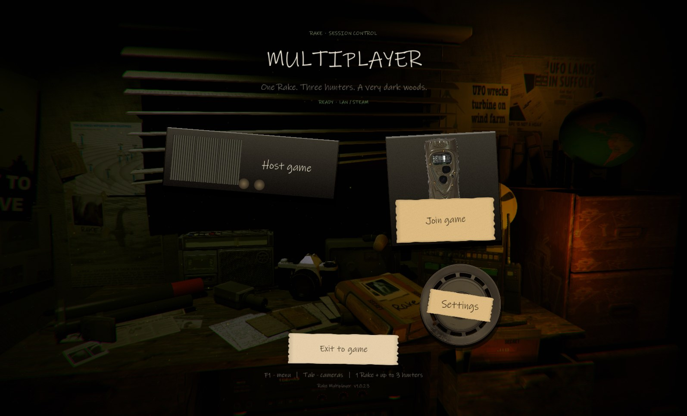
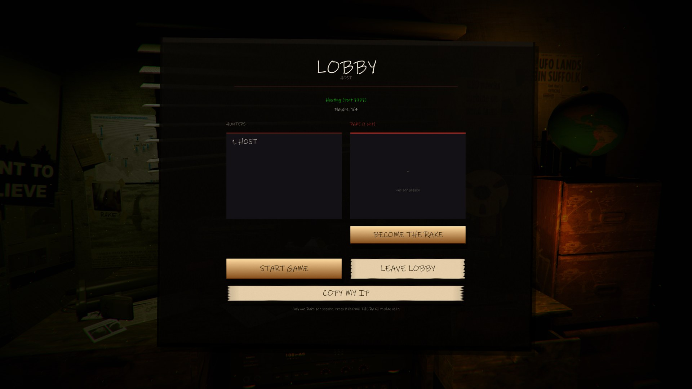
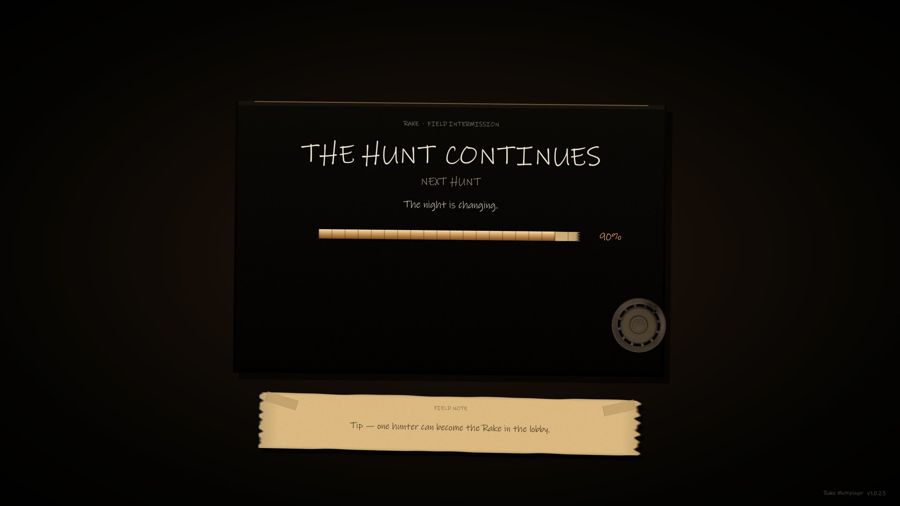
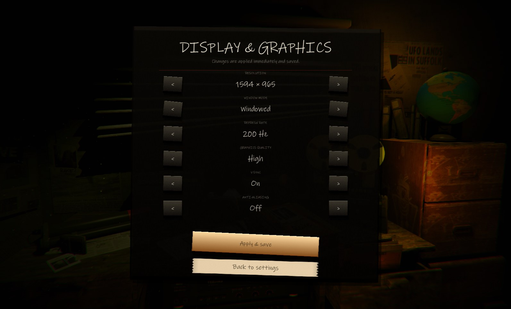
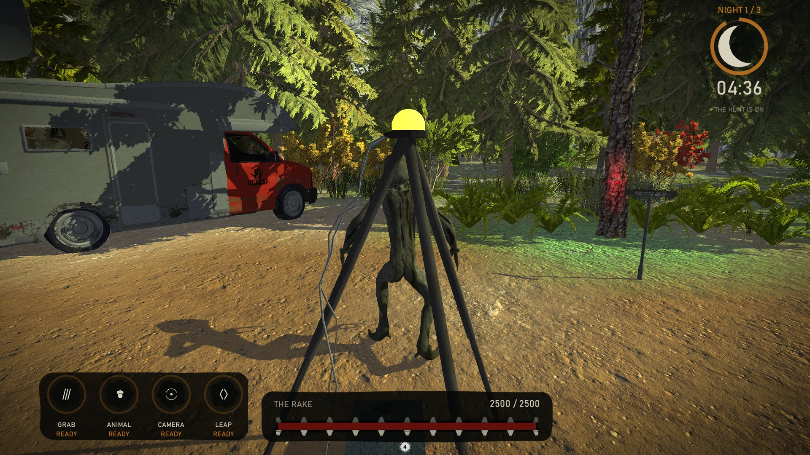

# Rake Multiplayer 1.1.4-alpha.1-Main

> **Main build.** This release is built from the `master` (Main) branch: graphics
> presets, the day/night level change, the HUD phase fix and the climbing guards.
> It does not include the optics or target-refresh work from the other branch.

**First public alpha** of the cooperative multiplayer mod for **Rake (2015)**.

> Alpha build: the core loop is playable, but balance, Steam stability and some UI
> details are still changing. LAN is the most reliable path in this build.

## Install

1. Download `RakeMultiplayerSetup.exe` below.
2. Point it at the folder containing `Rake.exe` / `Rake_Data`.
3. Launch Rake. The multiplayer menu is the main menu.

The installer adds BepInEx 5.4.23.2 (x86), the mod and Telepathy, and creates
`Uninstall_RakeMultiplayer.exe`.

## What's in this alpha

- **1 Rake + up to 3 hunters**, with a lobby and a single claimable Rake slot.
- **Host-authoritative world:** Rake AI, damage, loot, doors, traps, cameras and
  day/night phase.
- **LAN (TCP 7777)** and **Steam lobbies** (Spacewar app 480) with browser and password.
- **New interface** built over the vanilla menu room: main menu, host/join, Steam
  browser, lobby, settings, display settings and loading screen.
- **Display & graphics settings:** resolution, window mode, refresh rate, quality,
  V-Sync and anti-aliasing; saved and re-applied on launch.
- **HUD:** night phase/timer in the top-right, Rake health bar at the top center.

## Fixes

- The Rake no longer spawns on the level's staging platform under the map during the
  day: taking the Rake now puts it on forest ground near the hunters.

## Climbing

- **No more flicker.** The wall probe is volumetric and skips the Rake's own capsule, which
  used to be picked as a "wall" and made the climb blink off and on.
- **Round trunks hold.** The contact normal is smoothed instead of snapped, so the body no
  longer swings left and right on a tree while climbing it.
- **Hanging works:** release the keys and the Rake stays on the wall.
- **Ledges** are pulled over instead of dropping back down.
- **Space always lets go**, even while the jump is cooling down, and the wall cannot be
  grabbed again for two seconds.
- **First person** hides the body while climbing, so the Rake does not see its own arms or face.

## Performance overlay

Press `F8` in a match for a small panel in the top-left corner:

| Row | Meaning |
| --- | --- |
| `FRAME` | wall clock between two frames, ms |
| `CPU` | start of the frame to the end of camera rendering, ms |
| `GPU~` | `FRAME - CPU`: the part of the frame spent waiting for the device |
| `REND` | CPU time spent submitting the cameras, ms |
| `TRIS` | triangles of every visible mesh |
| `DRAW~` | draw calls: one per visible submesh plus one per uGUI element |
| `UI` | uGUI draw calls only |
| `OBJS` | visible renderers |

Unity 5 has no runtime GPU timer, so `GPU~` is an upper bound: with V-Sync on the
frame is capped and the row reads lower than the real device time. Terrain is not
included in `TRIS` (the engine exposes no terrain triangle count).

## Screenshots











## Graphics presets

`[Graphics] Preset` in the config, or **PERFORMANCE PROFILE** in Display & Graphics:

| Preset | LOD bias | Far clip | Shadows | FPS on a forest level |
| --- | --- | --- | --- | --- |
| OFF (VANILLA) | 1.5 | 300 | on | ~40 |
| LIGHT | 1.0 | 300 | on | ~47 |
| BALANCED | 0.7 | 220 | off | ~63 |
| AGGRESSIVE | 0.7 | 120 | off | ~82 |

Measured, not guessed: `docs/perf/graphics-steps.md` has the full staircase. Anti-aliasing,
texture size and pixel lights changed nothing on this CPU-bound frame, so the presets do not
touch them.

## Graphics config

`BepInEx/config/com.rake.multiplayer.cfg`:

| Option | Default | Meaning |
| --- | --- | --- |
| `[Graphics] TerrainShadows` | `false` | `false` turns the terrain shadow pass off (the terrain is one huge caster over every tree it draws); `true` keeps the level as shipped |

The value is applied on every level load and again after a graphics preset change, so it
survives switching quality in the menu. The result is written to the log:

```
[Graphics] terrain shadows OFF on 1 terrain(s) (was ON for 0, changed 0, 29748 tree instances) [scene Level_1(Day), quality High]
```


## Fixes in this build

- The day/night timer now **loads the matching level** (`Level_X(Day)` <-> `Level_X(Night)`)
  instead of only changing the lighting; the loading overlay also closes afterwards.
- Clients mark the cycle as running when the first phase packet arrives, so the HUD shows the
  real phase and the countdown instead of claiming night forever.
- The HUD takes the phase and the night number from the session cycle, falling back to the
  loaded level name before the first packet.
- Climbing no longer locks up: a zero/NaN approach direction or a stale release timer is
  detected and reset instead of silently refusing every wall.

## Fixes in 1.1.3

- **The Rake AI looked frozen.** During the day the AI Rake was teleported to the forest
  marker, which sits in the hunters' own camp, and the day gate stopped it from hunting:
  it stood motionless at arm's length. It now keeps at least 90 m from every hunter and
  silently steps deeper into the trees if someone walks up to it. Night hunting is
  unchanged (lurk -> stealth -> charge -> flee).
- **The F8 overlay threw every frame after a level change** (`An element with the same key
  already exists in the dictionary`). Unity reuses instance ids after a scene load, so a
  stale camera key compared equal to a fresh one; the camera timing copy can no longer
  throw, and the frame timings keep updating across day/night transitions.

## Fixes in 1.1.4

- **The Rake attack is a grab again.** It used to only send damage: the hunter could keep
  running, the camera never turned and the Rake swung on a loop. Now the hunter is held for
  the 1.2 s wind-up (movement frozen, mouse look taken away, camera turned to the Rake),
  hit once, and the grab ends with a 5 s break before another grab can start. Works for the
  host and for clients - the client plays the grab on its own machine.
- **The pause menu buttons work.** The plate canvas had no `GraphicRaycaster`, so clicks
  never reached CONTINUE or EXIT TO MENU.
- **CONTINUE really resumes**: the vanilla `Continue()` hides its own panel but leaves
  `isPaused` true, and the mod's plate follows that flag, so it stayed on top of a running
  game.
- **EXIT TO MENU leaves the match properly**: disconnects, aborts the session, stops the
  day/night cycle (it is DontDestroyOnLoad and otherwise kept changing levels over the menu),
  restores `Time.timeScale` and hides the plate. The main menu is the shipped
  `MainMenu_v2`, so the scene check now accepts level 0 instead of a name that does not exist.
- **"Ignore collision failed" spam** in the log is gone: the ragdoll only pairs colliders
  that are enabled, instead of asking Unity to ignore disabled ones every hit.

## Known limitations

- Steam hosting/browsing is still being tested across regions; use LAN if in doubt.
- Balance and UI details may change.
- x86 only, matching the original Unity 5 build.
- Some UI text is English while the game itself may be Russian.

## Controls

`F1` menu (in a match), `Tab` cameras, `F3` minimap, `F8` frame statistics, `Ctrl` sneak, `` ` `` developer console.

## Verification

- Packet and serialization tests: **86/86 passed**.
- Menu, lobby, loading, display settings and HUD checked on the running game.
